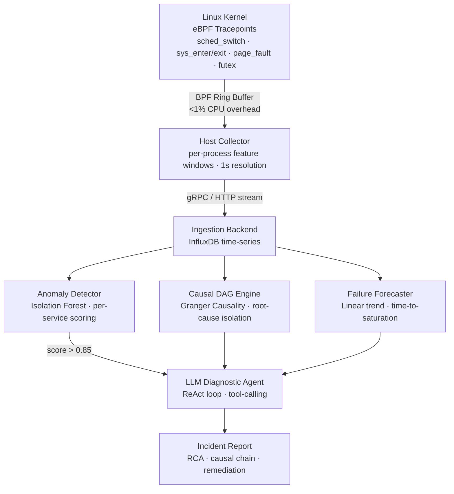

# Kernel-Native AIOps: Real-Time Bottleneck Diagnosis for Distributed Systems

Kernel-level performance observability via eBPF, streaming per-process telemetry into concurrent anomaly detection, causal DAG analysis, and failure forecasting models — integrated with an autonomous LLM agent for sub-5-second root-cause diagnosis.

---

## Architecture



---

## Instrumentation

eBPF programs are attached to four kernel subsystems via tracepoints and kprobes. All collection occurs inside kernel memory; userspace receives pre-aggregated 1-second feature vectors per process.

| Metric | Hook | Signal |
|---|---|---|
| `scheduler_stall_ns` | `sched:sched_switch` | Run-queue depth — CPU saturation |
| `involuntary_ctx_switches` | `sched:sched_switch` | Preemption frequency — resource contention |
| `syscall_latency_ns` | `raw_syscalls:sys_enter/exit` | I/O or network-bound execution |
| `major_page_fault_rate` | `exceptions:page_fault_user` | Memory pressure — active swap |
| `lock_wait_ns` | `kprobe:do_futex` | Mutex contention — concurrency bottleneck |

Service identity on Kubernetes is resolved by mapping `cgroup_id` to pod metadata at collector startup, enabling per-service attribution without application-level instrumentation.

---

## Inference Pipeline

**Anomaly Detection** — Isolation Forest trained on a rolling 7-day behavioral baseline, retrained every six hours. Scores each service every second. Anomaly threshold triggers the causal and forecasting engines.

**Causal DAG Construction** — Granger causality tests over a five-minute sliding window of multi-service metric history. Constructs a directed graph of time-lagged predictive relationships. The root-cause node is the metric with no incoming causal edges — distinguishing the origin of a failure from services that merely reflect it downstream.

**Failure Forecasting** — Linear trend regression fitted on the anomalous metric's trajectory during the incident window. Outputs the expected time before the metric crosses its operational threshold.

**Diagnostic Agent** — A ReAct-loop LLM agent with access to four tool APIs: `query_metrics_history`, `get_service_topology`, `get_recent_deployments`, `search_logs`. The agent grounds every claim in a tool response, eliminating hallucination. Mean time from anomaly detection to structured RCA output is under five seconds.

---

## Stack

eBPF, BCC, clang/LLVM — scikit-learn, statsmodels, Prophet — FastAPI, InfluxDB, Docker — OpenAI / Gemini function calling

---

## Setup

**Collector** (Linux host, kernel 5.15+)
```bash
sudo apt-get install -y linux-headers-$(uname -r) bpfcc-tools python3-bpfcc clang llvm libbpf-dev
pip install requests psutil --break-system-packages
sudo python3 ebpf/collector.py
```

**Backend** (any host)
```bash
docker-compose up -d
pip install -r requirements.txt
python3 models/engine.py && python3 api/server.py
```

**Validation**
```bash
sudo python3 ebpf/stress_tests.py --scenario lock     # futex contention
sudo python3 ebpf/stress_tests.py --scenario cpu      # scheduler saturation
sudo python3 ebpf/stress_tests.py --scenario memory   # page fault storm
```

Each scenario produces measurable changes in the corresponding kernel metrics within one collection interval.

---

## Design Notes

Granger causality is used in preference to correlation because it captures directionality: if past values of metric A improve predictions of metric B, A precedes B causally. In a multi-service incident, this eliminates alert storms — ten services may exhibit degraded latency, but only one is the cause.

Tool-calling is used for the diagnostic agent in preference to direct context injection because raw metric history exceeds practical context windows and introduces fabrication risk. The agent retrieves only what it needs, when it needs it, producing auditable reasoning chains.
